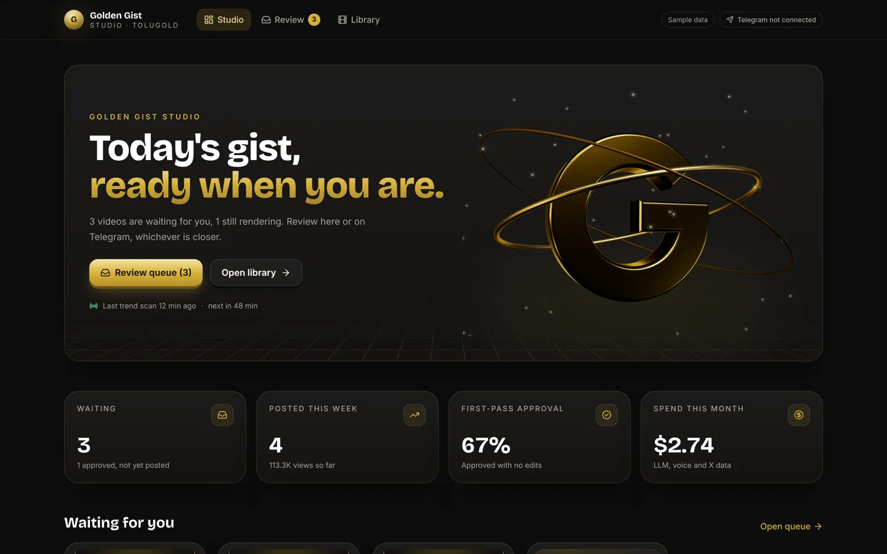

# Content Engine

An AI pipeline that turns what's trending in Nigeria into short vertical videos: it scouts trends, reads how people
are reacting, researches the facts, writes a script in the **Golden Gist** style, checks every claim against its
sources, voices it in a cloned voice, renders the video and sends it to Telegram and a 3D web dashboard for one-tap
approval. Nothing is published without a human decision.



## What it does

- **Trend scout**: X trends, Google Trends, YouTube, news feeds and football fixtures, clustered and scored by Claude.
- **Grounded scripts**: Claude writes the script; each factual claim is linked to evidence. A claim is _confirmed_
  only with two independent outlets, _reported_ with one (and must be attributed), otherwise _chatter_ (and must be
  framed as such). A separate judge checks support and wording; failing drafts never reach you.
- **Voice and video**: ElevenLabs cloned voice with character timings drive word-by-word captions in Remotion
  templates (Gist in 30 Seconds, Matchday Hype, Quick Explainer) plus a still for feeds.
- **Review anywhere**: Telegram buttons and the dashboard share one set of rules and one database row; the first
  decision wins. Approval sends a posting kit with captions sized per platform.
- **Private by design**: single-owner sign-in (Supabase Auth); only your email can sign up, once, with a server-side code.
- **Learning loop**: post links, metrics at 24h/72h (APIs or screenshot reading), cost per video, first-pass approval
  rate and predicted-vs-actual virality on the Insights page. An eval suite gates prompt changes in CI.

## Quick start

```bash
pnpm install
pnpm dev            # dashboard on http://localhost:3000 with fictional sample data
pnpm check          # format, lint, typecheck, tests
```

To run the real pipeline, add your keys (`docs/SETUP.md`) and follow `docs/TESTING.md`.

| Script                         | Does                                                |
| ------------------------------ | --------------------------------------------------- |
| `pnpm dev` / `pnpm dev:worker` | Dashboard / pipeline worker in watch mode           |
| `pnpm telegram:poll`           | Local Telegram bot without a public URL             |
| `pnpm telegram:webhook`        | Point Telegram at the deployed dashboard            |
| `pnpm eval`                    | Run the prompt eval suite (~$1)                     |
| `docker compose up -d --build` | Production stack: dashboard, worker, Inngest, HTTPS |

## Stack

TypeScript monorepo (pnpm) · Next.js 16 + React Three Fiber · Inngest (self-hosted) · Supabase Postgres · Claude
(Opus 5.5 / Haiku 5.5, structured outputs, web search) · ElevenLabs · Remotion · Cloudflare R2 · Telegram Bot API ·
Vitest · GitHub Actions · Docker + Caddy.

## Docs

- [Architecture](docs/ARCHITECTURE.md): components, pipeline, review model, API, data model
- [Setup](docs/SETUP.md): every key, where to get it, what it costs
- [Testing](docs/TESTING.md): automated checks and the manual test checklist
- [Deploy](docs/DEPLOY.md): one VPS with Docker Compose

Sample stories, people, clubs and outlets in the repository are fictional.
