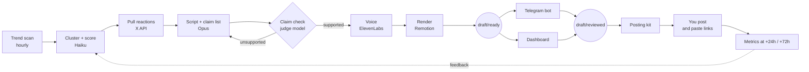

# Content Engine: architecture

A personal pipeline that finds what Nigerian social media is talking about, writes short scripts in the Golden Gist
style, checks every factual claim against sources, voices the script in a cloned voice, renders a vertical video and
hands it to a human for approval. Nothing is posted without that approval.

The engine is generic; **Golden Gist by Tolugold** is its first brand.

## Decisions

| Area | Choice | Why |
|---|---|---|
| Language | TypeScript everywhere (pnpm monorepo) | Remotion needs Node; one set of types shared by workers, bot and dashboard |
| Orchestration | Inngest (durable workflows) | The pipeline pauses for hours waiting for a human. `waitForEvent`, `sleepUntil`, retries and concurrency limits come built in |
| Database | Supabase Postgres | Relational data, Realtime for the dashboard, pgvector later for "covered this already?" |
| LLM | Claude: Haiku 5.5 for bulk triage, Opus 5.5 for scripts and the claim checker | Cheap where volume is high, strong where quality matters. Structured outputs on every call, prompt caching on the brand prompt |
| Voice | ElevenLabs, cloned voice, `with-timestamps` endpoint | Character timings drive word-by-word captions without a transcription step |
| Video | Remotion + FFmpeg, one template per tone | Branded, repeatable, near-zero marginal cost |
| Review | Telegram bot **and** web dashboard | Telegram for speed on the phone, dashboard for watching, downloading and history |
| Publishing | Manual, from a posting kit | No platform audits needed; trending sounds and AI labels added by hand |
| Storage | Cloudflare R2 | No egress fees; signed download links |
| Observability | Langfuse traces + `llm_calls` table | Cost per video, latency per stage, prompt versions |

## Pipeline



## Two review channels, one source of truth

You asked for the dashboard without losing Telegram, so both channels read and write the **same draft row**:

1. When a render finishes, the pipeline emits `draft/ready`. The Telegram bot **always** sends the preview with
   Approve / Edit / Reject buttons; the dashboard shows the same draft live. The dashboard is an extra consumer, never a
   replacement.
2. A decision from either channel goes through the same rules in `packages/core/src/review.ts`
   (`applyReview`, `editCaption`, `markPosted`).
3. The `reviews` table has `draft_id` as its primary key, so if you tap Approve on Telegram and click Reject on the web in
   the same second, exactly one insert wins. The other channel gets a `ReviewConflictError` and shows the existing
   decision.
4. The winner emits `draft/reviewed`. The paused Inngest workflow resumes, the Telegram message is edited
   ("Approved on the dashboard · 10:42"), and the dashboard refreshes.

Event names and payloads live in `packages/core/src/events.ts`.

## Claim ledger (fact-checking)

Every script comes with a list of factual claims. Each claim has:

- a **status**: `confirmed` (2+ independent outlets), `reported` (1 outlet) or `chatter` (social posts only);
- the **evidence** it rests on;
- a **verdict** from a separate judge call: `supported`, `misframed` or `unsupported`.

Wording rules per status: confirmed can be stated as fact, reported must name the outlet, chatter must be framed as a
claim ("X is saying..."). Approval is locked while any claim is not `supported`. Serious news always waits for a
human, whatever the verdicts.

## Repository layout

```
apps/web/            Next.js dashboard (Studio, Review queue, Library, draft detail, downloads)
packages/core/       Shared schemas (zod), review rules, platform limits, event contract
supabase/migrations/ Database schema
docs/                This document
```

Planned next to these: `apps/worker` (Inngest functions), `apps/bot` (Telegram), `packages/video` (Remotion
templates), `evals/` (golden set + graders).

## Status

| Piece | State |
|---|---|
| Dashboard UI, review rules, schema | Built, running on sample data |
| Supabase data layer | Next: swap `apps/web/lib/store.ts` to Supabase (signatures stay the same) |
| Telegram bot | Next: consumes `draft/ready`, writes through the same review rules |
| Trend scout, script writer, claim checker | Next |
| Voice + Remotion templates | Next |
| Evals in CI | Next |

## Portfolio metrics to track from day one

- First-pass approval rate (approved with no edits); shown on the Studio page
- Cost per published video (`llm_calls` + voice + X data)
- Predicted virality vs. actual views (calibration)
- Eval pass rate per prompt version
