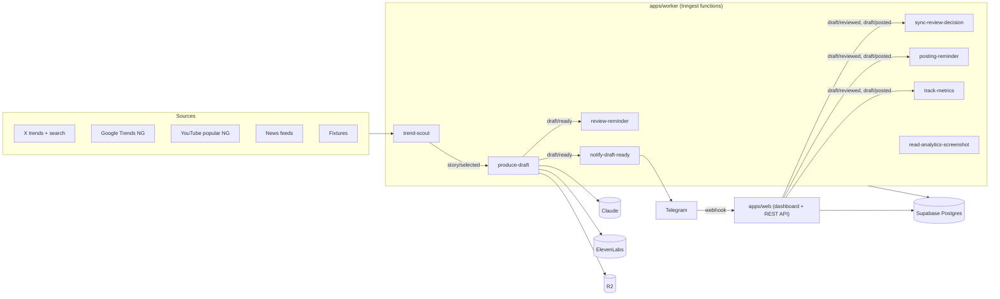

# Content Engine: architecture

A pipeline that finds what Nigerian social media is talking about, writes short scripts in the Golden Gist style, checks
every factual claim against sources, voices the script in a cloned voice, renders a vertical video and hands it to a
human for approval on Telegram or the web dashboard. Nothing is posted without that approval; posting itself is manual.

The engine is generic; **Golden Gist by Tolugold** is its first brand (`packages/core/src/settings.ts`).

## Components

| Package             | Responsibility                                                                                 |
| ------------------- | ---------------------------------------------------------------------------------------------- |
| `packages/core`     | Domain types (zod), review rules, platform limits, settings, pricing, insights. No I/O.        |
| `packages/config`   | Validated environment; per-feature key checks with clear errors                                |
| `packages/db`       | `Repository` contract with Supabase and in-memory implementations; sample data                 |
| `packages/services` | Inngest client, typed events, review service shared by web and bot                             |
| `packages/telegram` | Bot API client, message builders, update handler, webhook/poll scripts                         |
| `packages/ai`       | Claude tasks: triage, reactions, research (web search), writer, claim judge, screenshot reader |
| `packages/sources`  | Trend source adapters, reactions search, X/YouTube metrics                                     |
| `packages/media`    | R2 storage, ElevenLabs voice with timestamps, narration timing                                 |
| `packages/video`    | Remotion templates (one composition themed per tone) and render functions                      |
| `apps/worker`       | Inngest functions + HTTP server; renders videos                                                |
| `apps/web`          | Dashboard, REST API, Telegram webhook, media links                                             |
| `evals`             | Golden set, graders and runner for prompt regressions                                          |

## Pipeline (`produce-draft`)

1. **Save trend** with the scout's news items as evidence (every later cost is tied to this trend).
2. **Pull reactions** from X search; **analyse** them with Haiku: mood, tone, top takes, refined score, angle.
3. **Research** with Claude's web search; each cited passage becomes evidence (URL, outlet, snippet).
4. **Write** the script (Opus, structured output): scenes, captions per platform, hashtags, question, claims with evidence IDs.
5. **Check claims.** Status is computed from evidence (2+ outlets confirmed, 1 reported, 0 chatter); the judge checks
   support and wording. One revision with the judge's issues; if it still fails, the draft is stored as _failed_ and never voiced.
6. **Voice** the narration (scenes + outro) in one ElevenLabs call with character timings.
7. **Render** the MP4 and still with Remotion, upload to R2, mark the draft _pending review_, emit `draft/ready`.

Each step is retried on its own, so a render hiccup never re-runs (or re-bills) the writing steps.

## Two review channels, one source of truth

- `draft/ready` always triggers the Telegram preview. The dashboard reads the same row and refreshes every 30 seconds.
- Dashboard actions, the REST API and the Telegram handler all call `createReviewService()` (`packages/services`), which
  validates with the shared rules in `packages/core/src/review.ts` and writes through one SQL function per action.
- `reviews.draft_id` is a primary key and `review_draft()` locks the draft row, so when both channels answer at once
  exactly one wins and the other gets "already approved/rejected".
- `draft/reviewed` updates the Telegram preview, sends the posting kit and schedules a posting-time reminder.

## REST API (behind the dashboard password)

| Method | Path                                  | Result                                                                             |
| ------ | ------------------------------------- | ---------------------------------------------------------------------------------- |
| GET    | `/api/drafts?status=&tone=&q=&limit=` | Drafts, newest first                                                               |
| GET    | `/api/drafts/:id`                     | One draft with claims, evidence, review, posts, metrics, timeline                  |
| POST   | `/api/drafts/:id/review`              | `{decision:"approved"}` or `{decision:"rejected", reason}`; 409 if already decided |
| PUT    | `/api/drafts/:id/captions/:platform`  | `{text}`; idempotent; 422 over the platform limit                                  |
| PUT    | `/api/drafts/:id/posts/:platform`     | `{url}`; idempotent per platform                                                   |
| GET    | `/api/drafts/:id/media/:kind`         | Video or still via a signed link; `?download=1` to save                            |
| POST   | `/api/scans`                          | 202, asks the scout to run now                                                     |
| GET    | `/api/health`                         | Which integrations are configured (public)                                         |
| POST   | `/api/telegram/webhook`               | Telegram updates (secret-token verified)                                           |

Errors use RFC 9457 problem details (`{type, title, status, detail}`).

## Data model

`supabase/migrations/20261121000000_init.sql`: `trends`, `evidence`, `drafts`, `claims`, `reviews`, `edits`, `posts`,
`metrics`, `pipeline_events`, `usage`, `telegram_sessions`, `source_health`, plus the transactional functions
`create_draft`, `transition_draft`, `review_draft`, `edit_caption`, `record_post`. RLS is on everywhere; only the
server-side service role reads or writes.

## Observability and cost

Every paid call (Claude tokens and web searches, ElevenLabs characters, X reads) is written to `usage` with its trend,
stage, model and prompt version. The Insights page shows spend by stage, cost per posted video, first-pass approval
rate, your edits (feedback for prompt tuning) and predicted virality against actual views. Inngest's UI shows each run
step by step.

## Decisions worth knowing

| Decision                                        | Why                                                                                            |
| ----------------------------------------------- | ---------------------------------------------------------------------------------------------- |
| Workflow, not an autonomous agent               | Fixed steps are cheaper, testable and predictable; only research uses a tool loop (web search) |
| Claim status computed in code                   | "Confirmed" must mean two outlets, not the model's opinion                                     |
| Manual posting with a posting kit               | No platform audits; trending sounds and AI labels added by hand                                |
| Usage table instead of an external LLM-ops tool | One less service and key; cost per video comes from the same database                          |
| One Remotion composition themed per tone        | Three templates without three copies of the code                                               |
| Self-hosted Inngest                             | Durable waits (review, posting time, 24/72h metrics) with no extra account                     |
